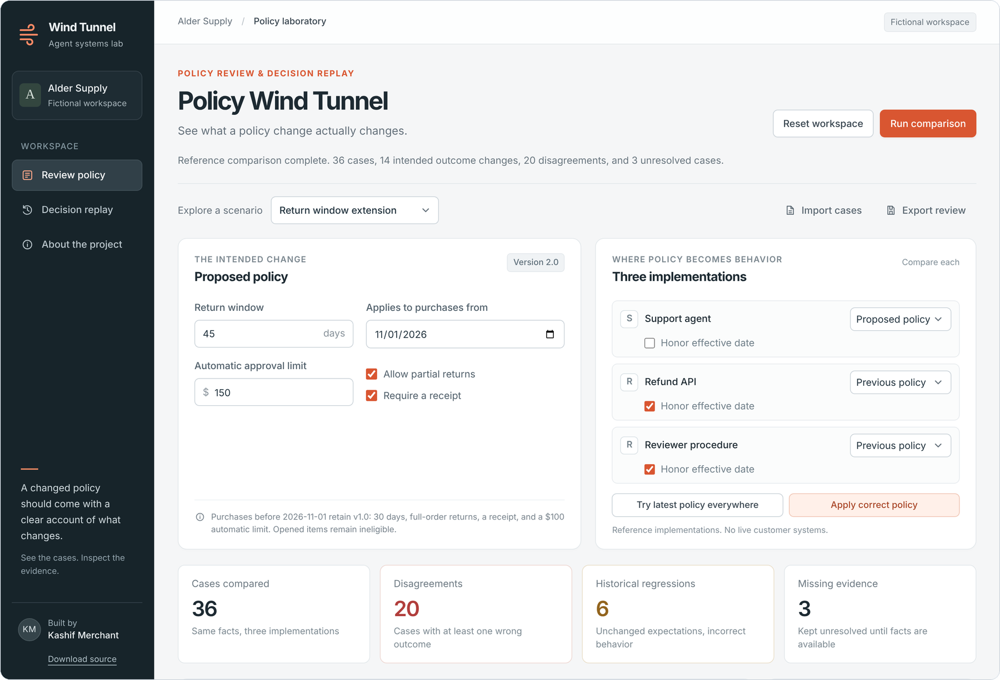
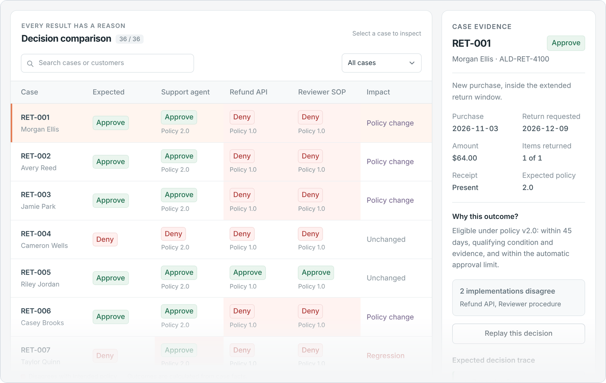

  

  <a href="#current-project"><b>Current project</b></a>&nbsp;&nbsp;·&nbsp;&nbsp;<a href="#the-series"><b>The series</b></a>&nbsp;&nbsp;·&nbsp;&nbsp;<a href="#how-i-approach-the-work"><b>Approach</b></a>

  
  

 

I build teams from the ground up and bring product, engineering, and operations together around real work. My focus is the judgment a useful agent needs:

> **Which decisions can it make on its own?** 
> **When should a person take over?** 
> **What evidence does that person need to assess the result?**

These independent projects make that judgment tangible. Each one uses a fictional workspace and repeatable cases, so you can inspect the behavior for yourself.

 

## Current project

### Policy Wind Tunnel &nbsp;with Decision Replay

**See what a policy change actually changes.** Change a business policy and see where its implementations disagree. Inspect the evidence behind a decision, test a repair, and check whether the repair breaks another case.

  
  
  

<table>
  <tr>
    <td width="33%" valign="top">
       
      <b>Compare</b> 
      Adjust the return window, effective date, partial returns, approval limit, and receipt rule. See the expected decision next to an agent, an API, and a reviewer procedure.
    </td>
    <td width="33%" valign="top">
       
      <b>Inspect</b> 
      Filter to disagreements or missing evidence. Open any decision to see its facts, the policy version that applied, and the rule trace.
    </td>
    <td width="33%" valign="top">
       
      <b>Repair</b> 
      Try a fix and check it against historical cases for regressions. Replay any case under any implementation, then export the review.
    </td>
  </tr>
</table>

 

  
  
  
  
  

 

## The series

Five working tools, each built around one product question.

| | Project | The question it answers | Status |
|:-:|:--|:--|:-:|
| **01** | **[Policy Wind Tunnel](https://policy-wind-tunnel-kashif.ksm5351.chatgpt.site)** Compare a policy change across every implementation, then test the repair. | *What does a policy change actually change?* |  |
| **02** | **[Promise-to-Proof](https://promise-to-proof-kashif.ksm5351.chatgpt.site)** Trace a corrected invoice from a support case to its delivery receipt. [View source](https://github.com/kashifsmerchant/kashifsmerchant/tree/main/projects/promise-to-proof). | *Did the right customer receive the promised invoice?* |  |
| **03** | **Undo Plan** Make recovery an inspectable, executable part of an action. | *Can this change be recovered?* |  |
| **04** | **Workstream Rebuilder** Test operating changes across the whole workflow, including the queues and exceptions they create. | *Does the whole workflow improve?* |  |
| **05** | **Workflow Compiler** Turn a demonstrated task into an editable workflow with explicit rules, assumptions, and tests. | *What did the demonstration leave out?* |  |

Planned projects get live links once their releases are built and verified.

 

## How I approach the work

| 01 · Start with the decision | 02 · Make uncertainty visible | 03 · Verify the outcome |
|:--|:--|:--|
| Define the outcome, the person accountable for it, and the evidence they need to make a useful choice. | Show what the system observed, what it inferred, and what still needs a person’s judgment. | Check the resulting state. Keep explanations connected to evidence, and make failure cases easy to inspect. |

 

---

  All examples in this series are fictional. The source is independent work and contains no employer code or customer data.

